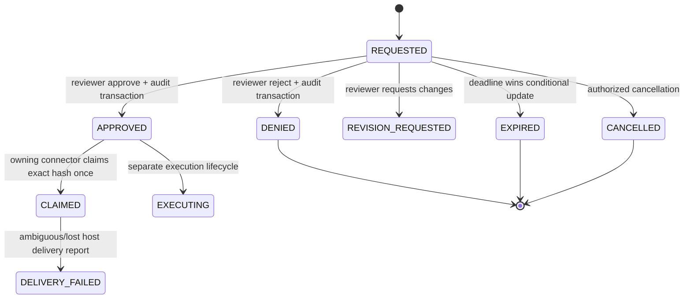

# Approval Connector Contract v1

**Status:** Slice 0 accepted. Provider runtime and broader application gates remain open under their respective slices.
**Scope:** Native-agent local connector to Control Tower API and Android reviewer.
**Authority:** [PRE_BILLING_WORK_LOCK.md](PRE_BILLING_WORK_LOCK.md) and the current approval models, lifecycle, repositories, and `/agents/approvals` routes.

This contract does not claim that either provider currently passes a real desktop-to-phone-to-same-invocation round trip. Provider support is established only for the exact adapter, documented event, version, and tested host path.

## 1. Identity and request binding

An external-agent request is authorized by the connector credential and resolves to one registered connector installation. The server derives `workspace_id` and `source_agent_id` from that authenticated registration; values supplied by a host payload cannot widen either scope.

The logical request identity is:

```text
(workspace_id, source_agent_id, source_invocation_id)
```

`source_agent_id` identifies the connector installation. `source_invocation_id` identifies one permission-gated invocation in one provider session. The provider adapter must reuse the same invocation identity when retrying that same invocation after a connection or connector restart. A different invocation must not reuse it.

The request record binds:

- workspace and project;
- provider, connector installation, provider session, and invocation;
- exact action content: title, summary, target branch, files/diffs/new content, test plan, rollback plan, and related work-order/task references;
- risk assessment and reasons;
- authenticated creator/provenance, creation/update timestamps, and expiry;
- current lifecycle status and immutable audit history.

Only server-authenticated workspace and installation identity are authoritative. Missing identity, invalid scope, or an unavailable durable read denies the request.

## 2. Frozen payload and reviewer decision

The reviewer acts on one persisted approval ID and sees the associated immutable action and risk context. At approval time, the server freezes the action payload hash. The connector may return `allow` only after it has read the approval through its authenticated installation, verified the same workspace/installation/invocation and exact frozen action payload, and successfully claimed delivery once.

`approved_payload_hash_version=2` hashes project/work-order, action content, provider/installation/session/invocation provenance, source task URL, workspace, and the complete risk assessment. New human approvals use v2. Backend and Antigravity/Codex hook implementations must compute the same canonical digest; parity tests cover both hooks. Version 1 preserves the historical action-only digest for reading existing records. Since v1 does not bind risk or workspace, the repository refuses to create a new connector delivery claim for a v1 approval. Existing v1 approvals remain visible but require a new approval/invocation before a connector can return allow. Already-created claims cannot be retroactively undone.

The human decision is an authenticated, idempotent state transition. A repeated decision for a request already moved from pending returns a conflict and cannot overwrite the winner. The repository compares the caller's complete expected approval snapshot and conditionally commits status, decision audit, linked task effects, and notification outbox changes in its supported transaction boundary. A PostgreSQL HTTP integration test now binds approval, project, workspace, task, and run repositories in two independent FastAPI processes and races approve against deny; exactly one decision, audit, and decision notification commit. This is explicit test binding for that route only. The default application has not completed PostgreSQL route or worker selection.

## 3. State model

Approval lifecycle and connector delivery are separate dimensions. `DELIVERY_FAILED` is a diagnostic outcome, not an approval status; a delivery failure never turns an approval into permission to retry the tool. A durable delivery claim means the server authorized one connector response attempt; it does not prove that the provider executed the tool.

| Approval state | Meaning | Permitted next state(s) |
| --- | --- | --- |
| `REQUESTED` | Awaiting reviewer decision | `APPROVED`, `DENIED`, `REVISION_REQUESTED`, `EXPIRED`, `CANCELLED` |
| `PENDING_REVIEW` | Legacy pending equivalent | `APPROVED`, `DENIED`, `EXPIRED`, `CANCELLED` |
| `APPROVED` | Reviewer approved the frozen request | `EXECUTING`, `CANCELLED`; connector delivery claim is separate |
| `DENIED` (`REJECTED` legacy) | Reviewer rejected the request | Terminal |
| `REVISION_REQUESTED` | Reviewer requires a revised request | New `REQUESTED` revision or `CANCELLED` |
| `EXPIRED` | Request deadline elapsed before a decision | Terminal |
| `CANCELLED` | Authorized cancellation | Terminal |
| `BLOCKED` | Policy blocked the request before approval | `CANCELLED`; no connector allow |
| `EXECUTING`, `READY_FOR_PR`, `FAILED`, `MERGED` | Later work/execution lifecycle | Governed by `approval_lifecycle.py`; not a fresh phone permission |

Connector delivery is recorded independently:

| Delivery state | Durable evidence | Behavior |
| --- | --- | --- |
| `UNCLAIMED` | No row in `approval_delivery_claims` | No connector may return allow unless the approved request can be claimed atomically |
| `CLAIMED` | Unique claim row for approval/workspace/installation/invocation plus `approval.delivery_claimed` audit | Exactly one v2 claim succeeds; v1 or subsequent claim attempts deny |
| `DELIVERY_FAILED` | Matching `approval_delivery_failures` row and `approval.delivery_failed` audit | Diagnostic only; claim remains consumed and no retry receives allow |



`CLAIMED` and `DELIVERY_FAILED` are delivery states, not values of the approval status enum. The diagram is explanatory; consumers must rely on persisted records and route responses.

## 4. Protocol and operations

Connector approval routes require `X-Aixion-Approval-Protocol: 1`. The server currently treats a missing version as legacy v1 for compatibility; adapters must send `1`. Explicitly unsupported values return HTTP 426 with the supported-version response header before the approval operation executes.

| Operation | Route | Required behavior |
| --- | --- | --- |
| Verify connector setup | `GET /agents/identity?provider={provider}&project_id={project_id}` | Authenticated read-only preflight; confirms token validity, registered provider, exact project scope, workspace assignment in production, and all five approval capabilities; returns installation identity and scope only, never the token |
| Create or resolve retry | `POST /agents/approvals` | Authenticated create capability; same logical identity is reusable only when payload hash and risk match, otherwise 409 |
| Read decision | `GET /agents/approvals/{id}/decision` | Authenticated read capability; request must belong to this installation; expiry is applied before returning the current durable state |
| Claim delivery | `POST /agents/approvals/{id}/consume` | Authenticated consume capability; exact owner, invocation, approved payload hash, and `APPROVED` status; unique atomic claim or deny |
| Report ambiguous delivery | `POST /agents/approvals/{id}/delivery-failure` | Authenticated report capability; requires the matching durable claim and exact identity/hash; diagnostic only |
| Expire own request | `POST /agents/approvals/{id}/expire` | Authenticated expire capability; closes only the owning installation's pending request |

Connector registrations need only the capabilities for operations they use. Missing capabilities deny. The current provider hooks' `--check` verifies all five approval capabilities before accepting setup as usable. Credentials must be scoped to workspace/project and installation, revocable, stored in the host's secure credential store, and excluded from logs. Provider adapters must validate host input before network access, use bounded waits, and emit redacted correlation diagnostics.

## 5. Idempotency, races, and failure behavior

- **Duplicate create, same identity and identical content/risk:** resolve to the existing approval; do not duplicate audit or notification records.
- **Duplicate create with changed action or risk:** HTTP 409; do not alter the existing request.
- **Approve/reject race:** one conditional transition commits; the loser receives conflict and cannot overwrite status or audit.
- **Approve/expiry race:** one conditional transition commits based on durable current status and deadline. Once expired, late approval cannot authorize delivery.
- **Linked task decision:** if a pending approval has one linked `AgentTask`, the task must still be `WAITING_FOR_APPROVAL` when the decision transaction commits. Approval, task transition, task timeline, audit, and notification records commit together. If the linked task has moved to another status, the decision conflicts and leaves both records unchanged. This check exists in the SQLite and PostgreSQL repositories; PostgreSQL route selection remains incomplete.
- **Linked task startup recovery:** local SQLite recovery may repair a task only from `WAITING_FOR_APPROVAL` to the approval-derived status, or repair a missing event when the task already has that status. It skips a task that has advanced or been cancelled, and does not schedule a run from that inconsistent state. PostgreSQL recovery is not yet bound to the application lifespan.
- **Linked task expiry:** if the pending approval has one matching `WAITING_FOR_APPROVAL` AgentTask, expiry commits the approval status, approval audit, task timeline note, task audit, task update timestamp, and task notification outbox row in one database transaction. The task status remains `WAITING_FOR_APPROVAL`; the expired approval is terminal and cannot authorize worker execution. Missing/mismatched task scope, multiple linked tasks, or any failed write rolls back the complete transition.
- **Operator cancels a waiting AgentTask:** the linked `REQUESTED`, `PENDING_REVIEW`, or `BLOCKED` approval is moved to `CANCELLED` in the same transaction as task cancellation, with an approval audit event and reviewer notification. Missing or mismatched approval state fails closed. If the approval is already denied, expired, or cancelled, the task can be cancelled without creating another approval transition. If the approval is already approved or otherwise active, cancellation conflicts because it cannot revoke a decision that may already have been delivered to a provider.
- **Duplicate decision tap:** no second transition or duplicate decision notification.
- **Wrong workspace, connector installation, session/invocation, request ID, or payload hash:** deny or conflict; never infer approval from a related request.
- **Legacy hash v1:** preserve historical verification for display/read compatibility, but do not create a connector delivery claim; require a new v2 approval.
- **Connector credential revoked, missing, malformed, or out of scope:** deny before returning allow.
- **Revocation races with consume:** `/consume` derives a one-way digest from the presented token and rechecks it against the current registered connector credential inside the same database transaction that inserts the at-most-once claim and claim audit. The digest is not persisted. SQLite serializes the check with `BEGIN IMMEDIATE`; PostgreSQL locks the connector, credential, and approval rows before writing the claim. If revocation/rotation commits first, consume returns 401 and writes no claim or claim audit. If consume obtains those locks first, the claim linearizes before revocation and revocation waits for that transaction. Deterministic HTTP regressions cover this race on both SQLite and the explicitly bound PostgreSQL route; the shared repository contract also covers both adapters.
- **API unavailable, timeout, malformed response, or approval read failure:** provider hook returns deny; it must not execute optimistically.
- **Consume claim reports false or conflicts:** deny; do not retry claim as a way to obtain another allow.
- **Claim commits but response is lost:** the next attempt sees the existing claim and denies. This sacrifices availability to preserve at-most-once authorization; a new provider invocation may be required.
- **Host response is lost after a successful claim:** report `DELIVERY_FAILED` where possible. It does not release the claim, replay permission, or prove whether the provider executed.
- **Connector restart:** retry the same invocation identity and read the durable approval. If the decision was already claimed, fail closed; never create a new identity solely to bypass a prior claim.
- **Backend restart:** durable PostgreSQL is the intended authority. The active application route/worker binding is still incomplete, so restart recovery is not certified across the full application.
- **Offline phone or host:** no approval can be delivered. Pending state remains server-side until decision, cancellation, or expiry; an offline or terminated agent cannot resume.

## 6. Provider adapter boundary

Each provider must map its documented native permission event to this contract and return only that provider's documented allow/deny shape. The adapter must keep the same paused invocation pending while polling and must not substitute a later invocation after an ambiguous claim.

- **Antigravity:** supported hook implementation exists; local automated coverage verifies that token revocation after an approved decision is read but before its at-most-once consume claim produces an API 401, creates no delivery claim, and makes the hook deny. A combined local hook/API test also confirms a due approval returned as `EXPIRED` during polling is denied without attempting consume. Combined hook/API regressions commit the consume claim, drop its successful response, and retry the same provider invocation against both SQLite and an explicitly bound PostgreSQL route test. The PostgreSQL case now runs the retry in a separately spawned API process against the same durable schema; both hook attempts deny, only one durable delivery claim exists, and one ambiguous-delivery diagnostic is recorded. This verifies cross-process durable claim recovery and the ambiguous-response boundary; it does not restart the PostgreSQL server or prove native Antigravity session resumption. Real same-session approve/reject, timeout, network-loss, and host sleep/wake evidence remains incomplete.
- **Codex:** the local synchronous `PermissionRequest` hook uses the provider's `tool_use_id` when it is present and well-formed. The documented event omits that field, so the adapter creates a fresh random invocation identity for each callback and keeps it through request creation, decision polling, and the at-most-once consume claim. This identity is not derived from the command payload, so identical calls do not collide. If the callback process is lost or restarted, a new callback receives a different identity and cannot inherit the previous approval; restart recovery for that callback is not provided. Missing session/turn fields, malformed input, timeout, API ambiguity, revocation, or a mismatched decision return an explicit denial. This is an implemented adapter, not certified native-session support: retain Slice 4 until an installed Codex build completes real same-invocation phone approve and deny tests. Hosted Codex tools outside this local hook are out of scope.

No generic MCP request, API test, UI demo, or simulated connector call proves native session resumption.

## 7. Acceptance status and downstream implementation gaps

**Slice 0 — ACCEPTED.** Its exit gate in `PRE_BILLING_WORK_LOCK.md` requires a provider-neutral request/decision contract and explicit fail-closed behavior for mismatch, expiry, replay, duplicate decisions, lost connections, and connector restart. Sections 1–6 define those identities, state transitions, transaction boundaries, and failure outcomes. The contract was reviewed against both adapters and the Android decision screen. The Android screen refuses decisions without a valid future expiry and requires verified provider identity for external requests. The Codex adapter binds each synchronous callback to an invocation ID: it uses a valid provider `tool_use_id` when present, otherwise it creates a fresh random ID for that callback. Missing session/turn identity and malformed provider IDs are denied.

The backend regression suite on 2026-10-21 passed **1,282 tests, 0 failures, 6 existing deprecation warnings** against the isolated PostgreSQL 17 test cluster. Run it from the repository root with:

```sh
AIXION_TEST_POSTGRES_DSN='host=/tmp/aixion-ct-pg.O8jwnb/socket port=55432 dbname=postgres user=madhuram' \
AIXION_PROFILE=test backend/.venv/bin/python -m pytest -q backend/tests
```

The suite covers SQLite/PostgreSQL approval repository contracts, decision/expiry races, at-most-once claims, identity and payload mismatches, timeout and network failure behavior, connector retry identity, credential revocation, and ambiguous/lost consume responses. The test server is isolated; this result does not certify production application binding or a native app session round trip.

The following are downstream gates, not open Slice 0 acceptance items:

1. **Slice 1:** complete PostgreSQL application route, worker, recovery, and migration binding; cross-process runtime evidence; SQLite production-profile refusal.
2. **Slices 3, 4, and 6:** real Antigravity and Codex same-invocation phone approval evidence. Antigravity's adapter is implemented but its local global hook is disabled and the phone was not attached during the latest readiness check. Codex's documented `PermissionRequest` schema omits provider `tool_use_id`; the adapter creates a callback-scoped random ID when absent, but remains unverified against an installed Codex app and phone round trip. Slice 4 remains open.
3. **Slice 5:** physical-device validation of the approval UX and critical navigation/actions.

Therefore this document is the accepted Slice 0 contract baseline only. It does not claim that the connectors, app-wide PostgreSQL runtime, physical-device flows, hosted reachability, push delivery, staging handoff, or production product exit gates are complete.
